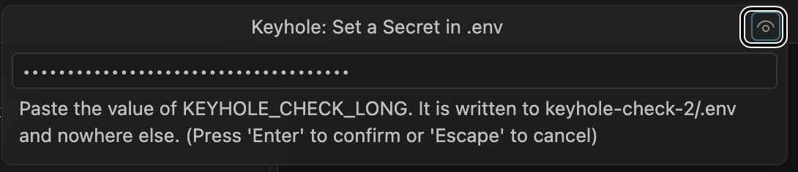

# Keyhole

A small VS Code extension that puts a secret (an API key, a token) into your
project's `.env` through a masked box, so the secret never has to appear in a
conversation with an AI assistant.

[Product page](https://jlumbroso.github.io/keyhole/) ·
[Manual](https://jlumbroso.github.io/keyhole-docs/)

Start with the manual's harmless walkthrough and its assistant-specific file
protections.

When you need to give a project a token for GitHub, Neon, Render or another
service, you run **Keyhole: Set a Secret in .env…**. Keyhole asks for the
variable's name, checks with git that `.env` is ignored and not tracked, takes
the value in a masked box, and appends it to `.env`. The value goes from the box
to the file and nowhere else. An assistant can still help you find and set up the
token, by name, without the value ever passing through the chat.

## See it

Both pictures are the real extension in VS Code on macOS, in a throwaway folder with a
made-up value. The value is not a secret.

*The masked box. It says where the value is going, and the button at the right shows what you
typed if you need to check it.*

*Setting a variable that already has a value asks first. The question names the existing value
by a short keyprint and its length, never by the value itself.*

## What it does

1. **Asks for a name, not a value, first.** For example `DATABASE_URL`. Names are safe to
   discuss; values are not.
2. **Checks git before it writes.** Through VS Code's own Git extension, Keyhole asks
   whether `.env` is already tracked (git would keep tracking it despite an ignore rule) and
   whether it is ignored. If it is not ignored, Keyhole offers to add it to `.gitignore`
   first, and says what it recommends and why. If it is tracked, it tells you how to go on and
   does not write. If git cannot be asked (the Git extension is off), it writes nothing it cannot
   check. The same goes for a repository VS Code's Git extension did not open (git refuses
   some, for example when the folder belongs to another user): Keyhole finds the `.git` itself,
   says so, and writes nothing. If there is no git repository at all, it says so and writes,
   since nothing can commit the file by accident from there.
3. **Takes the value in a masked box.** There is a button to show what you typed, which hides
   the value again when you switch to another app. Both boxes have names for screen readers.
4. **Appends to `.env` under a comment line.** If the variable is already set, Keyhole asks
   before replacing it; the old line stays in the file and the new comment says which line it
   supersedes.
5. **Recognizes a value without showing it.** Messages and the log name a value by its public
   prefix and a short hash (for a value of 32 characters or more, also its last four, as the
   service's own page does), for example `<keyprint:ghp_…f9c2#06c47309/>`. A shorter value
   shows none of its characters. In the code, a secret is a type that prints as `[redacted]`
   by every route a string is made and refuses to serialize; tests check that.

## Scope of the protection

**Keyhole's promise is about the conversation, not about your machine.** Its input and result
path is built to keep the value out of chat, prompts, links and logs. An assistant that has
access to your files and a shell can still read `.env` itself, and Keyhole cannot stop that.
The guide to
[keeping secrets out of the conversation](docs/manual/keeping-secrets-out-of-the-conversation.md)
explains what each assistant application offers to reduce accidental reads, and where the
protection ends. Git ignoring a file also does not remove a value from history that already
contains it.

## Requirements

- VS Code desktop **1.134.0 or later**, with its built-in **Git extension enabled** (Keyhole
  says so if it is not) and the project open as a folder.
- **Checked by hand on macOS with VS Code 1.141.0 only**, including with VoiceOver. Windows and
  Linux are untested.
- Keyhole makes no network request and opens no port. A check in the build keeps that a fact,
  not a promise.

## Not here yet

Designed in this repository's decisions, not built: a model asking for a secret by name with a
link, a list of requests and drafts, step-by-step instructions for a service's token page, and
writing to an assistant's own settings file. Keyhole today is the part you do yourself.

## Install

Search for "Keyhole" in VS Code's Extensions view, or run
`code --install-extension jlumbroso.keyhole`.

## Twin project

[Porthole](https://github.com/jlumbroso/porthole) shows a page in a floating window above
your work. The two share their crew and, later, their way of receiving a request from a
terminal (a `vscode://` link).

## License

[Apache License 2.0](LICENSE); see [NOTICE](NOTICE).

## How this is built

With the human-AI collaboration template
([ADRs4AI/human-ai-collaboration-template-A](https://github.com/ADRs4AI/human-ai-collaboration-template-A),
3.12 in progress): decisions and open questions live in `docs/adr/`, and the
crew coordinates through `docs/inbox/`. See [CLAUDE.md](CLAUDE.md).
